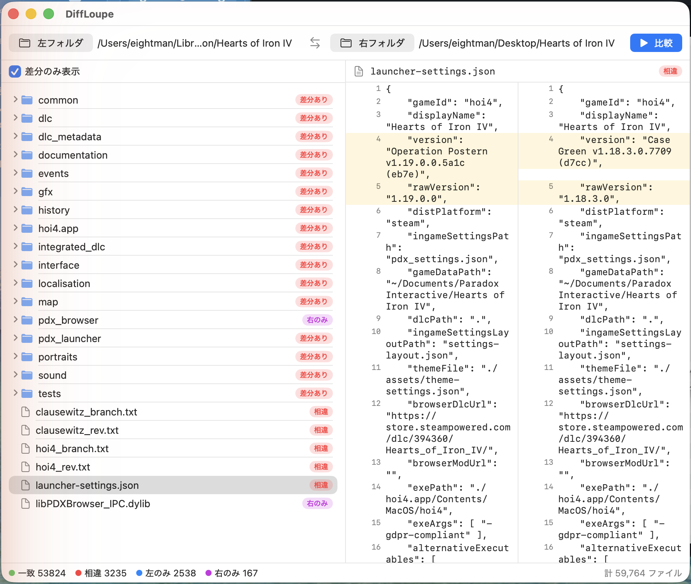

# DiffLoupe macOSネイティブ(Swift)版

「WinMerge難民のためのMac差分ツール」。
フォルダ納品物・バックアップ・写真フォルダの突き合わせ向けの、
軽くて即動く**2ペインのフォルダ比較**アプリです。SwiftUI + Swift Concurrencyによる
macOSネイティブ実装で、**外部依存ゼロ**(Foundation / CryptoKit / SwiftUIのみ)。



実フォルダ(約6万ファイルのゲームフォルダ同士)を比較した様子。
ツリーは「一致 / 相違 / 左のみ / 右のみ」に色分けされ、相違のテキストファイルを
選ぶと行単位の差分が横並びで表示されます(追加=緑、削除=赤、変更=黄)。

## 機能(v1)

- 左右フォルダの再帰比較。判定は **サイズ比較 → 一致時のみSHA-256** の段階方式
  (詳細は [SPEC.md](SPEC.md))
- 分類ツリー表示(一致 / 相違 / 左のみ / 右のみ / エラー、ディレクトリは子孫を集約)
- 「差分のみ表示」フィルタ
- テキストファイルの行単位差分ビュー(UTF-8、バイナリ自動判別、CRLF対応)
- `.git` / `.DS_Store` / `node_modules` を既定で除外(設定でトグル可)
- 走査・比較は完全非同期(進捗表示+キャンセル可能)。1万ファイル規模でもUIは固まりません
- ウィンドウサイズ・位置の記憶

## 動作環境

- macOS 13 (Ventura) 以降
- Apple Silicon / Intel 両対応(ユニバーサルバイナリ)
- ビルドには Xcode 15 以降(Swift 5.9+)

## ダウンロード / リリース

配布物の内容・インストール手順・初回起動時の注意は [RELEASE_NOTES.md](RELEASE_NOTES.md) にまとめています。

配布用の `.dmg` / `.zip` は次のコマンドで生成できます(成果物は `dist/` に出力。リポジトリには含めません):

```bash
cd SwiftUI
./Scripts/make_release.sh
# => dist/DiffLoupe-<version>.dmg, dist/DiffLoupe-<version>-macOS.zip
```

> 本アプリは公証(Notarization)未取得のため、配布物の初回起動時は
> 右クリック →「開く」か `xattr -cr /Applications/DiffLoupe.app` が必要です(詳細は RELEASE_NOTES.md)。

## ビルド方法

```bash
cd SwiftUI

# ビルド
xcodebuild -scheme DiffLoupe -project DiffLoupe.xcodeproj build

# テスト(同梱のTestFixturesで分類結果を検証)
xcodebuild -scheme DiffLoupe -project DiffLoupe.xcodeproj test

# ビルド成果物の場所を調べて起動する場合
xcodebuild -scheme DiffLoupe -project DiffLoupe.xcodeproj -showBuildSettings \
  | grep -m1 BUILT_PRODUCTS_DIR
open <BUILT_PRODUCTS_DIR>/DiffLoupe.app
```

Xcodeで開く場合は `SwiftUI/DiffLoupe.xcodeproj` を開き、スキーム `DiffLoupe` を実行してください。

### 大規模フォルダでの動作確認

1万ファイルの比較用フォルダペアを生成するスクリプトを同梱しています:

```bash
./Scripts/make_stress_fixtures.sh /tmp/DiffLoupeStress 10000
# アプリで /tmp/DiffLoupeStress/left と /tmp/DiffLoupeStress/right を比較
```

参考値: 10,000ファイル(うち相違100・左のみ100)の比較は Apple Silicon 実機で 1秒未満。
比較処理はすべてバックグラウンド実行され、走査中・比較中もUI操作とキャンセルが可能です。

## プロジェクト構造

```
SwiftUI/
├── DiffLoupe.xcodeproj/        # Xcodeプロジェクト(スキーム: DiffLoupe)
├── DiffLoupe/
│   ├── DiffLoupeApp.swift      # エントリポイント
│   ├── Models/DiffModels.swift # 分類ステータス・エントリ・ツリーノード
│   ├── Engine/
│   │   ├── FolderComparator.swift  # 走査+段階判定エンジン(SPEC.md §2)
│   │   ├── LineDiff.swift          # 行単位差分(CollectionDifference/Myers法)
│   │   ├── TextFileLoader.swift    # テキスト読込(エンコード自動判定)・バイナリ判別
│   │   ├── ImageDiffEngine.swift   # 画像読込・ピクセル差分生成
│   │   ├── StructuredNormalizer.swift # JSON/XML/CSV/TSV正規化
│   │   ├── HexDiff.swift            # バイナリHex比較
│   │   ├── DirectoryWatcher.swift   # フォルダ変更監視
│   │   ├── SyncPlan.swift           # 読み取り専用コピー計画
│   │   ├── ThreeWayDiff.swift       # 読み取り専用3-way差分
│   │   └── GitSnapshot.swift        # gitリポジトリ検出・refスナップショット実体化(SPEC.md §2.7)
│   └── UI/                     # SwiftUIビュー群
├── DiffLoupeTests/             # XCTest(分類・行差分・読込の検証)
├── TestFixtures/               # テスト用フォルダペア(同一・相違・片側のみ・バイナリ等)
├── Scripts/
│   ├── make_app_icon.sh        # resources/icons/icon.png から AppIcon.icns を生成
│   └── make_stress_fixtures.sh # 1万ファイル規模の検証用フォルダ生成
├── SPEC.md                     # 比較アルゴリズム仕様書(C++/Python版の読解結果を含む)
├── WORK_LOG.md                 # 作業ログ(判断の記録)
└── README.md                   # このファイル
```

## 対応済みの主な機能(v1.1以降で追加)

- 画像比較: 左右並べ / 重ね合わせ / ブリンク / 差分ハイライト / スライス(ワイプ)の5モード
- 文字コード自動判定: UTF-8(BOM有無) / UTF-16・32(BOM付き) / Shift_JIS / EUC-JP / ISO-2022-JP
  (判定できないファイルはバイナリ扱い。詳細は SPEC.md §2.6)
- git連携: フォルダがgit作業ツリーの場合、各サイド独立にブランチ・タグ・任意refを
  選択して任意リビジョン間比較が可能(SPEC.md §2.7)
- 内容比較モード(設定画面): 改行コード・行末空白・連続空白・大文字小文字の無視/正規化
  (フォルダ比較と詳細差分の両方に反映。詳細は SPEC.md §2.9)
- ユーザー除外glob: 1行1パターンで任意のファイル/ディレクトリを除外(*・**・?)
- リネーム/移動候補の検出: 片側のみのファイル同士を内容で照合して候補表示
- 詳細差分ビューに左右のサイズ・変更日時・POSIXパーミッションとリネーム候補を表示
- 文字単位の行内差分表示: 変更行の文字差分を強調表示(Unicode/nil安全、左右計1,200文字上限)
- 差分行ジャンプ: `⌘↓` / `⌘↑` と前後ボタンで差分行を移動(未選択状態からのジャンプに対応)
- テキスト検索: 左右テキストの同時検索、大文字小文字切り替え、検索ヒットのハイライト
- コンテキスト折りたたみ: 連続5行以上の一致行を集約し、クリックまたは「全行表示」で展開
- 長い行の水平スクロール: 2ペインの行対応と行番号を維持したまま長い行を閲覧
- 左右フォルダ・Git refの交換: `⌘⇧S` または交換ボタンで左右を一括交換
- Finderフォルダドラッグ&ドロップ: 単一フォルダだけを安全に受け付け
- 比較履歴: 左右パス・Git ref・日時を最大10件保存し、存在するフォルダを復元
- 比較レポート出力: HTML / CSV / JSON / Markdown (NSSavePanelと上書き確認に対応)
- 構造化比較: JSON / XML / CSV / TSVの表記揺れを正規化して比較。JSONキー順、XML属性順、CSV/TSVの引用符・区切りに対応し、8MiB上限とBOM除去を備える
- Hex比較: 16バイト行、ASCII表示、差分バイト強調。表示上限は8MiBで、超過時は未比較を明示する
- 高度なフィルタ: include / exclude glob(`*` / `?` / `**`)とソース管理・ビルド・Web/Node.js・macOSメタデータのプリセット
- フォルダ変更監視: opt-inのポーリング自動再比較。連続3回で一時停止し、Git refのスナップショット側は監視しない
- コピー計画プレビュー: 左→右 / 右→左のコピー候補、ディレクトリ作成、競合、保持、blockedを表示する読み取り専用計画。コピー・削除・上書きの適用は行わない
- 3-way差分: base / left / rightのテキストを読み取り専用で比較し、片側変更・同一変更・競合・挿入削除を表示。40,000行上限で保護し、マージ適用・保存は行わない

## CLIツール(diffloupe)とWinMerge互換運用

- `Package.swift` に macOS 13+ の SwiftPM構成を追加。`diffloupe`実行ファイルと
  `DiffLoupeCore`/`DiffLoupeCLI`を提供し、GUIと同じ比較エンジンを再利用する。
- CLIのフォルダ比較はWinMergeに合わせて**既定では非再帰**。`-r`、`--recursive`、`/r`で再帰、
  `--no-recursive`、`/r-`で非再帰を明示できる。GUIアプリの既定再帰動作は維持する。
- WinMerge連携用に`/u`、`/ul`、`/um`、`/ur`、`/wl`、`/wm`、`/wr`、`/minimize`、
  `/maximize`、`/noninteractive`、`/x`、`/xq`、`/dl`、`/dm`、`/dr`、`/or`、
  `/enableexitcode`を受理する。GUI専用スイッチとラベル指定はCLIでは無操作、`/x`/`/xq`は
  進捗抑止へマップする。
- `/or <path>`または`--output`でHTML/CSV/JSON/Markdownレポートを書き出す。CLIは既存ファイルを
  上書きせず、親ディレクトリ不在もエラーにする。`/or`で拡張子を判別できない場合はHTMLを使う。
- 通常の終了コードは`0`=一致、`1`=差異、`2`=引数・パスエラー、`3`=処理エラー/キャンセル。
  `/enableexitcode`指定時はWinMerge相当の`0`/`1`/`2`へエラー系を縮約する。完全なドロップイン互換
  ではなく、3-wayマージやGUI操作は対象外である。
- 検証(現ワークツリーの実測): `swift test` 187件0失敗、Xcodeの`xcodebuild test` 212件0失敗、
  `Scripts/verify_cli.sh`は終了コード19項目+レポート内容2項目を検証して`ALL PASSED`。
  `xcodebuild build`と`git diff --check`も成功している。
- 画像比較の操作性: 左右 / 重ね合わせ / ブリンク / 差分 / スライスの5モードで共有する
  `ImageViewport`を追加。0.25x〜4.0xの倍率スライダー、拡大・縮小・リセット、ドラッグパン、
  `MagnificationGesture`によるピンチ操作に対応し、異寸法画像は共通キャンバスを使う。
- 画像差分の閾値は0〜255で調整でき、400msのデバウンスでスライダー操作中の再計算連打を抑える。
  狭いウィンドウではツールバーを横スクロールでき、メタデータ警告はグリッド下に表示する。
- 画像比較を含む自動検証: 現ワークツリーのXcode 212件0失敗、SwiftPM 187件0失敗。
  ピンチ、ドラッグパン、スライス境界、狭幅ツールバーの実機操作は未検証である。

## スコープ外(実装していないもの)

以下は意図的に実装していません:

- 3-wayマージの適用・保存
- ファイル編集
- フォルダ同期の実適用(コピー・削除・上書き)

App Sandboxは無効です(Mac App Store配布は今後の検討事項)。
フォルダへのアクセスは必ず `NSOpenPanel` 経由で行います。

WinMerge互換は、CLIスイッチ・終了コード・フィルタ・構造化比較などの**互換サブセット**です。
WinMerge本体との同一入力による直接比較、`.flt`フィルタファイル、プラグイン、Windows GUI固有操作の
完全互換は未検証または未対応です。参考にした公式資料は
[Filters](https://manual.winmerge.org/en/Filters.html)、
[FltFile](https://manual.winmerge.org/en/FltFile.html)、
[Table compare](https://manual.winmerge.org/en/Table_compare.html)、
[Plugins](https://manual.winmerge.org/en/Plugins.html)、
[WinMerge本体](https://github.com/WinMerge/winmerge)です。

## 関連ドキュメント

- [SPEC.md](SPEC.md) — 比較アルゴリズム仕様(C++版・Python版との相違点を含む)
- [WORK_LOG.md](WORK_LOG.md) — フェーズごとの作業ログ
- リポジトリ直下の [README.md](../README.md) — プロジェクト全体の入口
- [legacy/cpp/README.md](../legacy/cpp/README.md) — C++/Qt版(旧実装)について

## ライセンスの発行と管理 (Pro版)

DiffLoupeはEd25519公開鍵暗号方式によるオフラインライセンス認証を採用しています。

*   **鍵の管理方針**: 
    *   **公開鍵** はアプリ本体（`LicenseManager.swift`）にハードコードされ、リポジトリにコミットされます。
    *   **秘密鍵** は絶対にリポジトリにコミットしてはならず、販売・管理システム（発行サーバー等）でのみ厳重に管理されます。
*   **ライセンス発行ツール**:
    *   開発・テスト向けの発行スクリプトは `tools/generate_license.swift` に用意されています。
    *   このスクリプトには秘密鍵が含まれるため、`.gitignore` でリポジトリの対象外にしており、実運用時は安全な外部環境で同様の署名処理を行います。
*   **ペイロード仕様**:
    *   `product`: `"DiffLoupe.Pro"` (固定)
    *   `name`: 購入者名・会社名
    *   `issuedAt`: 発行日（YYYY-MM-DD）
    *   `version`: 対象バージョン（例："1.0"）
